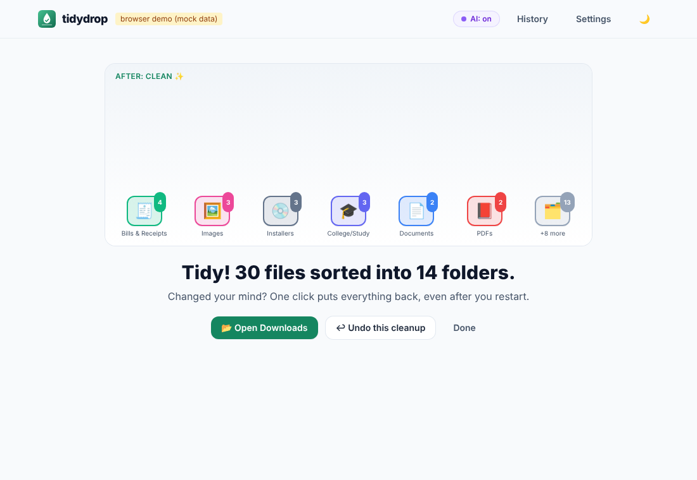
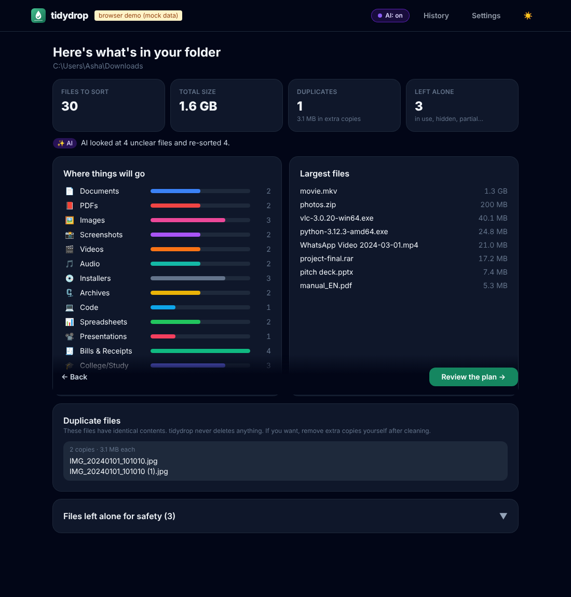
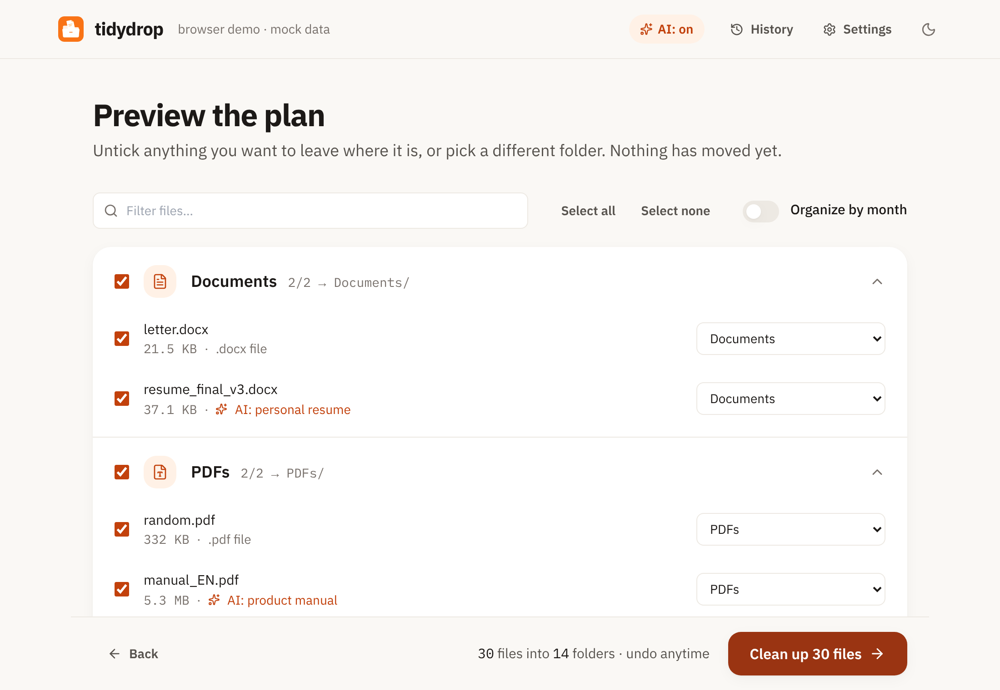
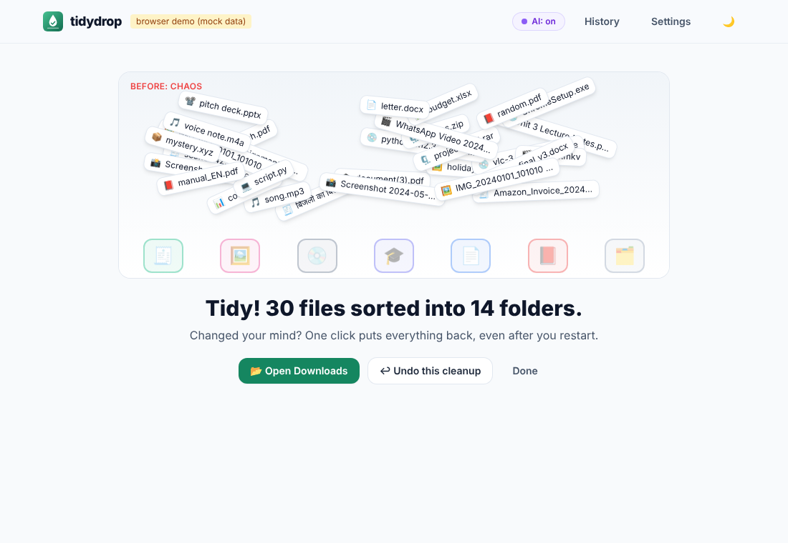

<p align="center">
  
</p>

<h1 align="center">tidydrop</h1>

<p align="center"><strong>Chaos to clean in 10 seconds, nothing leaves your computer, and one click undoes everything.</strong></p>

<p align="center">
  <!-- DEMO GIF PLACEHOLDER: record the before/after screen and save as docs/demo.gif -->
  
</p>

tidydrop is a free, open-source desktop app that sorts a messy **Downloads** folder into sensible folders
(Documents, PDFs, Images, Screenshots, Installers, Bills & Receipts, College/Study, …). It uses smart rules
out of the box and, if you want, a small AI model that runs **on your own computer**.

Built for normal people: Windows first, then macOS and Linux.

| Stats | Preview | Done |
|---|---|---|
|  |  |  |

---

## 🛡️ Safety: how tidydrop protects your files

Safety is the product. These rules are enforced in the Rust core and covered by tests.

- **Never deletes anything.** tidydrop only *moves* files. Not even duplicates are deleted — they're only shown to you.
- **Preview first, always.** You see every file, where it will go, and *why* ("name contains invoice", "AI: electricity bill"). Untick anything, or pick another folder, before a single file moves.
- **One-click undo, even after a restart.** Every move is written to a journal on your computer *before* it happens. "Undo" puts every file back where it was and removes the empty folders tidydrop created. Undo works from the app or the CLI, any time later.
- **Never overwrites.** If a file with the same name is already there, the new one becomes `name (1).ext`. This uses the operating system's "fail if it exists" move, so even a race can't overwrite a file. Undo follows the same rule.
- **Leaves risky files alone:**
  - downloads still in progress (`.crdownload`, `.part`, `.tmp`, `.download`, `.partial`, `.opdownload`, … and the empty placeholder file next to them),
  - files changed in the last 2 minutes (configurable),
  - files open in another program (Windows),
  - hidden and system files (`desktop.ini`, `Thumbs.db`, `.DS_Store`, Office `~$` lock files),
  - shortcuts/symlinks, and anything inside sub-folders (only top-level files are sorted).
- **Re-checks right before moving.** If a file changed or disappeared after the preview, it's skipped.
- **Stays inside the folder you chose.** Destinations are computed by the Rust core, can't contain `..`, and never go through links/junctions. tidydrop refuses to clean a drive root, your whole home folder, or system folders.
- **Handles real-world names:** Hindi, Japanese, emoji, very long Windows paths (> 260 characters), cloud "online-only" files (never downloaded just to scan them).
- **Fully offline.** No accounts, no telemetry, no network calls — except to Ollama on `localhost` if you enable AI. Non-local AI addresses are rejected.

## 📦 Install

> Installers come from the [Releases page](https://github.com/AdyWakes/AI-Downloads-Cleaner/releases). They're not code-signed yet, so your OS may warn you the first time.

**Windows 10/11**
1. Download `tidydrop_x.y.z_x64-setup.exe` (or the `.msi`).
2. Run it. If SmartScreen says "Windows protected your PC", click **More info → Run anyway**.
3. Open **tidydrop** from the Start menu.

**macOS 11+**
1. Download `tidydrop_x.y.z_universal.dmg`, open it, drag tidydrop to Applications.
2. The first time: right-click the app → **Open** → **Open** (it isn't notarized yet).

**Linux**
- `.AppImage`: `chmod +x tidydrop_*.AppImage && ./tidydrop_*.AppImage`
- `.deb` (Ubuntu/Debian): `sudo apt install ./tidydrop_*_amd64.deb`

## ✨ Using it

1. tidydrop opens with your Downloads folder selected (click **Change…** for another folder).
2. Click **Scan folder** — this only looks. You get stats: file count, total size, largest files, duplicates, and what it left alone for safety.
3. **Review the plan.** Untick files, change a file's folder, or type a custom folder. Toggle **Organize by month** if you like `Images/2024-05`.
4. Click **Clean up** and watch the files fly into place.
5. Not happy? **Undo this cleanup** — or later via **History**.

## 🤖 The AI tier (optional, local)

tidydrop has two tiers:

1. **Smart rules (always on).** File type + filename keywords (whole words, any language): `invoice`, `receipt`, `GST`, `order`, `बिल`, `रसीद` → Bills & Receipts; `assignment`, `lecture`, `syllabus` → College/Study; `Screenshot …` → Screenshots; and so on. Edit everything in **Settings → Folders / Rules** (stored in `config.json`).
2. **Local AI (optional).** Only *unclear* files (a generic `scan0042.pdf`, `document(3).docx`, unknown types) are sent to a small model running in [Ollama](https://ollama.com) on your computer, with the filename and a short text snippet (first page of a PDF, first lines of a .txt/.docx; 400 characters by default). The model must reply in strict JSON with a category from your list; anything invalid, slow or broken falls back to the rules. Files are sent in batches and progress is shown.

**Enable it:**
1. Install Ollama from <https://ollama.com/download> (the app has a one-click guide: click the **AI: off** badge).
2. In a terminal: `ollama pull llama3.2:3b` (≈2 GB, once). `qwen2.5:3b` also works well.
3. The badge turns **AI: on**. Change the model in **Settings → AI**.

## ⌨️ CLI

The same engine is available as `tidydrop-cli` (shares settings and undo history with the app):

```bash
tidydrop-cli scan                      # stats for your Downloads folder, changes nothing
tidydrop-cli plan ~/Downloads          # show what would move where, and why
tidydrop-cli plan --json > plan.json   # machine-readable
tidydrop-cli clean --by-month          # show plan, ask y/N, move
tidydrop-cli clean -y --only Installers --only Archives
tidydrop-cli undo                      # undo the last cleanup
tidydrop-cli history                   # list cleanups (undo a specific one with: undo --id <id>)
tidydrop-cli ai-status                 # is Ollama available?
tidydrop-cli config path               # where settings and the undo journal live
```

Use `--no-ai` to skip the AI tier, and `--home <dir>` (or `TIDYDROP_HOME`) for a portable/test setup.

## 🧑‍💻 Development

Requirements: Rust (stable), Node 20+, and the [Tauri prerequisites](https://tauri.app/start/prerequisites/) for your OS (on Linux: `libwebkit2gtk-4.1-dev librsvg2-dev libappindicator3-dev`).

```bash
npm ci
npm run tauri dev        # run the desktop app
npm run dev              # UI only, in a browser, with a mock backend (no files touched)
cargo test               # core + CLI tests (no WebKit needed)
cargo run -p tidydrop-cli -- plan ~/Downloads
npm run tauri build      # build installers for your OS
```

Layout:

```
crates/tidydrop-core   all file logic: scanner, rules, AI, plan, apply, journal, undo (+ tests)
crates/tidydrop-cli    command-line interface
src-tauri              Tauri v2 shell: thin commands over the core
src                    React + TypeScript + Tailwind UI
```

Releases: pushing a tag like `v0.1.0` runs `.github/workflows/release.yml`, which builds Windows (`.msi`, `.exe`), macOS (`.dmg`) and Linux (`.AppImage`, `.deb`) installers plus CLI archives into a **draft** GitHub release.

## 🤝 Contributing

Contributions are very welcome — see [CONTRIBUTING.md](CONTRIBUTING.md). The golden rule: **no change may delete, overwrite or lose a user's file**. Anything touching `apply`, `undo`, `paths` or `scanner` needs a test.

### Good first issues

1. **Watch-folder mode** — optionally sort new downloads automatically (still journaled and undoable), with a tray icon.
2. **Custom rule templates** — one-click presets like "Student", "Freelancer (invoices by client)", "Photographer (RAW/JPEG split)".
3. **More languages** — translate the UI (start with Hindi) and add filename keywords for more languages (Tamil, Bengali, Spanish, …) to the default rules.
4. **"Open file location" + thumbnails in the preview** — let users peek at a file before deciding.
5. **Duplicate helper** — after cleaning, let users *choose* to move extra copies into a `Duplicates` folder (never delete), with undo.

## License

MIT © tidydrop contributors
